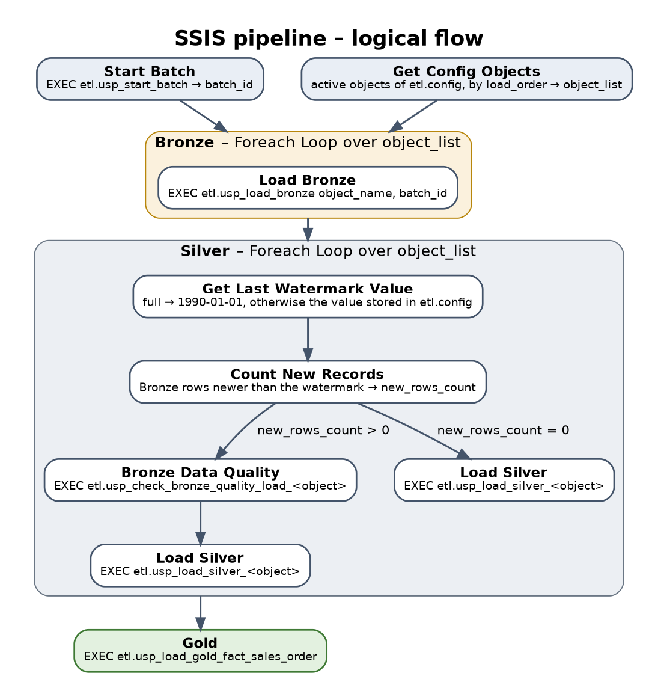

# SSIS Pipeline

This document explains the **logic** of the SSIS pipeline that orchestrates the data warehouse. SSIS only orchestrates: the business logic lives in the stored procedures of the `etl` schema (see the scripts in `Scripts/`).

The SSIS project files and the connection settings are **not published** in this repository. Everything needed to understand the pipeline is here.



---

## Order of execution

| Step | Task                    | What it does                                                                                       |
|-----:|-------------------------|----------------------------------------------------------------------------------------------------|
| 1    | **Start Batch**         | Creates the run in `etl.batch` and stores its number in the variable `batch_id`                    |
| 2    | **Get Config Objects**  | Reads the active objects of `etl.config`, ordered by `load_order`, into the variable `object_list`  |
| 3    | **Bronze** (loop)       | For each object: `EXEC etl.usp_load_bronze ?, ?` (object, batch). Full objects are reloaded; incremental objects read only the changes with SQL Server Change Data Capture (`etl.usp_load_bronze_cdc`) |
| 4    | **Silver** (loop)       | For each object: counts the rows to process, checks their quality, loads Silver and moves the Silver register (details below) |
| 5    | **Gold**                | Loads the fact table with `etl.usp_load_gold_fact_sales_order` (Release 1: always a full reload from Silver) |
| 6    | **End Batch**           | Closes the run: `EXEC etl.usp_end_batch ?, 'succeeded'` (parameter: `batch_id`)                     |

Steps 1 and 2 are independent; Bronze starts when both have finished. Each step starts only when the previous one succeeded: a failure stops the pipeline.

**OnError event handler** (package level, task *End Batch Failed*): `EXEC etl.usp_end_batch ?, 'failed'`, with the same `batch_id`. Errors bubble up from every task to the package, so one handler closes the run as `failed` whatever task fails.

## Two bookmarks, one per hop

| Hop               | Bookmark (in `etl.config`) | Contains                         | Moved by                                           |
|-------------------|----------------------------|----------------------------------|----------------------------------------------------|
| Source → Bronze   | `last_lsn`                 | How far the CDC log was read     | `etl.usp_load_bronze_cdc`, in the same transaction as the Bronze rows |
| Bronze → Silver   | `last_silver_batch_id`     | Last batch processed by Silver with success | The task **Update Silver Register**, only after Load Silver succeeded (or when there is nothing to process) |

The Silver register is what makes the incremental pipeline safe: Count New Records, the quality check and the Silver load all read **the Bronze rows with a batch greater than the register**. If a run fails after Bronze, the register does not move, and the next run processes the rows left behind together with the new ones.

## Run log: who writes what

The package opens and closes the **run**; the procedures open and close their own **steps**.

| Who                          | Procedure         | Table              | When                                         |
|------------------------------|-------------------|--------------------|----------------------------------------------|
| SSIS, Start Batch            | `usp_start_batch` | `etl.batch`        | First task: new run `running`; runs left open become `aborted` |
| every load and quality check | `usp_audit_start` | `etl.load_audit`   | Start of the procedure: step `running`       |
| every load and quality check | `usp_audit_end`   | `etl.load_audit`   | End of the procedure: `succeeded` or `failed`, counts, error |
| SSIS, End Batch / OnError    | `usp_end_batch`   | `etl.batch`        | Last task or failure: run `succeeded` or `failed` |

`usp_end_batch` does not trust the package alone: the run is `succeeded` only if SSIS says so **and** no step of `etl.load_audit` failed. Steps still `running` (a procedure stopped by a timeout) are closed as `failed`.

A query on `etl.load_audit` for one `batch_id` shows the whole path of every object: Bronze load, quality check, Silver load, Gold load.

## What happens for each object in the Silver loop

| Task                       | What it does                                                                                              |
|----------------------------|-----------------------------------------------------------------------------------------------------------|
| **Count New Records**      | Counts the Bronze rows with `dwh_batch_id` greater than the Silver register of the object, into `new_rows_count` |
| **Bronze Data Quality**    | Runs `etl.usp_check_bronze_quality_load_<object>` on those rows (latest version of each key, deletions excluded) |
| **Load Silver**            | Runs `etl.usp_load_silver_<object>`: full objects are reloaded, incremental objects are merged (SCD1 / SCD2, soft delete) |
| **Update Silver Register** | `UPDATE etl.config SET last_silver_batch_id = ? WHERE object_name = ?` (batch, object)                     |

The path depends on `new_rows_count`. The two precedence constraints that leave Count New Records are **mutually exclusive**:

| Condition (Expression **and** Constraint) | Path                                                                  |
|-------------------------------------------|-----------------------------------------------------------------------|
| `@[User::new_rows_count] > 0`             | Bronze Data Quality → Load Silver → Update Silver Register             |
| `@[User::new_rows_count] == 0`            | Update Silver Register only: nothing to check, nothing to load         |

Update Silver Register has two incoming constraints combined with a **logical OR**: it runs after whichever path was taken.

> **Lesson learned.** If both constraints use the same expression (`> 0`), Update Silver Register runs **in parallel** with the quality check and the Silver load: the register moves while they are still running and they find no rows to process. With full loads the bug is invisible (Silver does not read the register); with incremental loads Silver silently loads nothing. The two expressions must always be opposite.

## Variables

| Variable                                | Type     | Meaning                                                              |
|-----------------------------------------|----------|----------------------------------------------------------------------|
| `batch_id`                              | Int64    | Run created by Start Batch, passed to every procedure                |
| `object_list`                           | Object   | Active objects read from `etl.config`                                |
| `current_object_name`                   | String   | Object of the current loop iteration                                 |
| `check_query`                           | String   | Counts the Bronze rows of the current object with a batch greater than its Silver register |
| `new_rows_count`                        | Int32    | Result of Count New Records                                          |
| `current_data_quality_stored_procedure` | String   | `EXEC etl.usp_check_bronze_quality_load_<object> <batch_id>`         |
| `current_silver_load_stored_procedure`  | String   | `EXEC etl.usp_load_silver_<object> <batch_id>`                       |
| `current_sp_gold_fact_sales_order`      | String   | `EXEC etl.usp_load_gold_fact_sales_order <batch_id>`                 |

Expression of `check_query`:

```
"SELECT COUNT(*) AS NewRows
FROM [DWH_AdventureWorks2025].bronze.erp_"
+ @[User::current_object_name]
+ " WHERE dwh_batch_id > (SELECT ISNULL(last_silver_batch_id, 0)
FROM [DWH_AdventureWorks2025].etl.config
WHERE object_name = '"
+ @[User::current_object_name]
+ "')"
```

`batch_id` is also the parameter of End Batch, Update Silver Register and of the OnError event handler.

The procedure names are built from `current_object_name`, so **a new object is added with one row in `etl.config` and no change to the package**.

## Design notes

- **Full and incremental**: `load_type` in `etl.config`. `full` reloads the whole table every night; `incremental` reads only the changes with SQL Server CDC (inserts, updates and deletes). An SCD2 object must be incremental, otherwise the full reload of Silver loses its history.
- **The load type is decided by the procedures**, not by the package: the package is the same for full and incremental objects.
- **Run log**: every run is closed in `etl.batch` and every step is logged in `etl.load_audit`, so a failure is found with one query, without opening the SSIS logs.
- **Metadata-driven**: the list of objects, their order and their load type come from `etl.config`.
- **One batch per run**: every object of the run shares the same `batch_id`, so the rows, the quality findings and the run log can be traced to one execution.
- **One run at a time**: Start Batch closes the runs still open as `aborted`, so two runs must never overlap.
- **Recovery**: a failed run moves no bookmark that it did not complete; the next run catches up.
- **Refresh**: the package is started by SQL Server Agent, outside business hours (see the [Source System Analysis](Source_System_Analysis.md)). SQL Server Agent must also run the CDC capture and cleanup jobs on the source.
