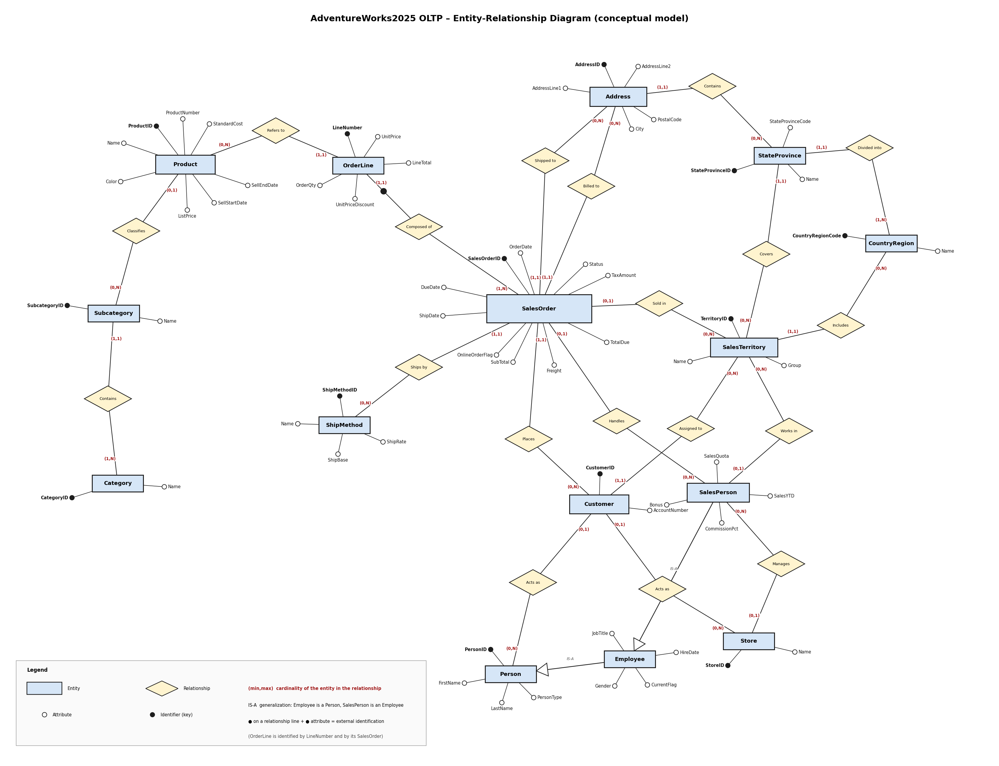

# Source System Analysis - AdventureWorks2025 OLTP

> **Kick-off workshop notes.** This document records what we learned in the first meeting with the AdventureWorks IT department and the business owners, **before** any design or development started. It is the starting point of the project: the data model, the business rules and the load strategy of the data warehouse come from here.

## Table of Contents

1. [Workshop Summary](#1-workshop-summary)
2. [Business Context](#2-business-context)
3. [Source System Overview](#3-source-system-overview)
4. [Data Model](#4-data-model)
5. [Business Rules](#5-business-rules)
6. [Data Quality Expectations](#6-data-quality-expectations)
7. [Extract & Load Strategy](#7-extract--load-strategy)
8. [Decisions and Open Questions](#8-decisions-and-open-questions)
9. [Next Steps](#9-next-steps)
10. [Follow-up: Change Data Capture](#10-follow-up-change-data-capture)

---

## 1. Workshop Summary

| Item                | Detail                                                                                              |
|---------------------|-----------------------------------------------------------------------------------------------------|
| Meeting             | First on-site meeting with AdventureWorks (kick-off and requirements gathering)                     |
| Participants        | IT Operations manager, database administrator, Sales manager, Finance controller, BI/reporting lead |
| Goal                | Understand the source database, the business processes and the rules to apply, before designing    |
| What we received    | ER diagram, table and column documentation, access rules, glossary, data owners                    |
| What we agreed      | Scope of the first release, history to keep, load strategy, access and schedule                    |
| Output              | This document, then the architecture, the [naming conventions](Naming_Conventions.md) and the build   |

---

## 2. Business Context

### 2.1 What the business wants

AdventureWorks sells bicycles, components and accessories, to shops (resellers) and directly to consumers (online). The business has an operational system (OLTP) that is good for taking orders, but it is **not built for analysis**: the data is normalized in many tables, it keeps no history of changes, and heavy reports slow down the application.

The business asked for one place with clean, historical data, to answer these questions:

| Area                   | Question the business wants to answer                                          |
|------------------------|--------------------------------------------------------------------------------|
| **Sales trends**       | How do sales, tax and freight evolve by month, year and territory?             |
| **Product performance**| Which products, subcategories and categories sell the most, and at which price?|
| **Customer behavior**  | Who buys (shops or individuals), how much, and through which channel?          |
| **Sales people**       | How do sales people and territories perform against quota and commission?      |

### 2.2 Who owns the data

The database is owned and operated by **IT Operations**. The meaning of the data and the business rules belong to the departments:

| Business domain      | Owner (role)        | Main tables                                         |
|----------------------|---------------------|-----------------------------------------------------|
| Sales & Marketing    | Sales manager       | Orders, customers, stores, sales people, territories|
| Production           | Product manager     | Products, subcategories, categories                 |
| Human Resources      | HR manager          | Employees                                           |
| Finance              | Finance controller  | Totals, tax, freight, shipping costs                |
| Shared               | IT Operations       | Persons, addresses, countries and states            |

These owners approve the business rules and are the contact for data quality problems.

### 2.3 Business processes supported by the source

Order-to-cash is the process in scope: a customer (shop or individual) places a **sales order** through a sales person or online, the order has **lines** (one per product), it is shipped with a **ship method** and it is closed or cancelled. Production, purchasing and inventory processes exist in the database but are **out of scope** for the first release.

---

## 3. Source System Overview

| Topic                | What IT told us                                                                           |
|----------------------|-------------------------------------------------------------------------------------------|
| Database engine      | Microsoft SQL Server                                                                      |
| Database             | `AdventureWorks2025`                                                                      |
| Schemas              | `Sales`, `Production`, `Person`, `HumanResources`, `Purchasing`, `dbo`                    |
| Environment          | We read from a copy of the production database, on the same SQL Server instance as the DWH |
| Integration method   | Direct read with SQL queries (three-part names, for example `AdventureWorks2025.Sales.Store`) |
| Change tracking      | **CDC is not enabled**. Every table has a `ModifiedDate` column, filled by the application. *Follow-up: CDC was enabled on the 11 incremental tables, see [section 10](#10-follow-up-change-data-capture)* |
| Access               | A dedicated ETL account with **SELECT only** permission on the schemas in scope           |
| Availability window  | Extracts run **at night, outside business hours**                                         |
| Volumes              | Small: the biggest table has about 120,000 rows (see [section 4.2](#42-tables-in-scope))  |

### 3.1 Documentation received

| Document                                  | Provided by          | Used for                                              |
|-------------------------------------------|----------------------|-------------------------------------------------------|
| ER diagram of the database                | IT Operations        | Understand tables and relationships ([section 4](#4-data-model)) |
| Table and column documentation            | Database administrator | Data types, nullability, keys, `ModifiedDate`         |
| Business glossary                         | Business departments | Definitions in [section 5](#5-business-rules)         |
| Data owners and stewards                  | Business departments | Who to ask for each domain ([section 2.2](#22-who-owns-the-data)) |
| Access and security rules                 | IT Operations        | ETL account, read-only permission                     |

---

## 4. Data Model

### 4.1 ER diagram

This is the Entity-Relationship diagram shown by the IT team, limited to the entities we need. It is a **conceptual** model: it shows the business entities, how they relate and their main attributes, not the technical columns of the tables.

How to read it:

| Symbol                         | Meaning                                                                                  |
|--------------------------------|------------------------------------------------------------------------------------------|
| Rectangle                      | **Entity** (for example `SalesOrder`, `Customer`, `Product`)                             |
| Diamond                        | **Relationship** between entities (for example `Places`, `Composed of`)                  |
| Small empty circle             | **Attribute** of an entity                                                               |
| Small black circle             | **Identifier** (key) of an entity                                                        |
| `(min,max)` near an entity     | **Cardinality**: how many times an entity takes part in the relationship (`(0,N)` = zero or many, `(1,1)` = exactly one) |
| Triangle (IS-A)                | **Generalization**: an `Employee` is a `Person`, a `SalesPerson` is an `Employee`        |
| Black circle on a relationship line and on an attribute | **External identification**: an `OrderLine` is identified by its `LineNumber` and by the `SalesOrder` it belongs to |

Points to notice in the diagram:

- `SalesOrder` is the center of the model: customer, sales person, territory, ship method and the two addresses (billing and shipping) all point to it.
- An order is made of one or more lines (`OrderLine`), and every line refers to one product.
- A customer can be a person, a store, or both (a person who works for a store).
- Products are classified by subcategory and category. A product can have no subcategory.
- Territories, states and countries form the geography used for sales reporting.
- Entities that exist in the database but are not loaded (for example the technical entity that generates the shared id of person, store and employee) are not shown: see [section 4.3](#43-tables-out-of-scope-first-release).

### 4.2 Tables in scope

| Source table                    | What it contains                         | Business key                          | Approx. rows | Changes over time              | Load        | History |
|---------------------------------|------------------------------------------|---------------------------------------|-------------:|--------------------------------|-------------|---------|
| `Production.ProductCategory`    | Product categories                       | `ProductCategoryID`                   | 4            | Almost never                   | Full        | SCD1    |
| `Production.ProductSubcategory` | Product subcategories                    | `ProductSubcategoryID`                | 37           | Almost never                   | Full        | SCD1    |
| `Production.Product`            | Products with price and cost             | `ProductID`                           | 500          | Price and cost change          | Incremental (CDC) | SCD2    |
| `Sales.Customer`                | Customers (shop or individual)           | `CustomerID`                          | 20,000       | Store, person or territory change | Incremental (CDC) | SCD2 |
| `Sales.Store`                   | Shops that buy                           | `BusinessEntityID`                    | 700          | Rarely                         | Incremental (CDC) | SCD1    |
| `Sales.SalesPerson`             | Sales people, quota, commission          | `BusinessEntityID`                    | 17           | Territory, quota and bonus change | Incremental (CDC) | SCD2 |
| `Sales.SalesTerritory`          | Sales territories                        | `TerritoryID`                         | 10           | Almost never                   | Full        | SCD1    |
| `Purchasing.ShipMethod`         | Shipping methods and costs               | `ShipMethodID`                        | 5            | Almost never                   | Full        | SCD1    |
| `Sales.SalesOrderHeader`        | One row per order                        | `SalesOrderID`                        | 31,000       | New orders, ship date and status | Incremental (CDC) | SCD1  |
| `Sales.SalesOrderDetail`        | One row per order line                   | `SalesOrderID` + `SalesOrderDetailID` | 121,000      | New lines                      | Incremental (CDC) | SCD1    |
| `Person.Person`                 | People (customers and employees)         | `BusinessEntityID`                    | 20,000       | Name changes                   | Incremental (CDC) | SCD1    |
| `Person.Address`                | Addresses                                | `AddressID`                           | 19,600       | Rarely                         | Incremental (CDC) | SCD1    |
| `Person.StateProvince`          | States and provinces                     | `StateProvinceID`                     | 181          | Almost never                   | Incremental (CDC) | SCD1    |
| `Person.CountryRegion`          | Countries                                | `CountryRegionCode`                   | 238          | Almost never                   | Incremental (CDC) | SCD1    |
| `HumanResources.Employee`       | Employees                                | `BusinessEntityID`                    | 290          | Job title, status              | Incremental (CDC) | SCD1    |

> Row counts are the approximate figures reported by IT at the meeting. They are confirmed with a `COUNT(*)` on each table during the first load.
>
> *Follow-up:* the Load column shows the final decision taken after the analysis of [section 10](#10-follow-up-change-data-capture): the 4 small SCD1 lookup tables stay full, every other table is loaded incrementally with CDC.

### 4.3 Tables out of scope (first release)

| Source table                                   | Why it is not loaded                                                                 |
|------------------------------------------------|--------------------------------------------------------------------------------------|
| `Person.BusinessEntity`                        | Technical table that only generates the shared id of person, store and employee       |
| `Person.BusinessEntityAddress`                 | Links people and stores to addresses. Not needed: orders point to the address directly|
| `Sales.SpecialOfferProduct`, `Sales.SpecialOffer` | Promotions: not requested for the first release (the order line keeps `SpecialOfferID`) |
| `Sales.CreditCard`, `Sales.CurrencyRate`       | Payment and currency conversion: not requested                                       |
| `Production.*` (work orders, bill of materials, inventory) | Manufacturing and stock analysis: planned for a later phase               |
| `Purchasing.*` (vendors, purchase orders)      | Procurement analysis: planned for a later phase                                      |
| `HumanResources.*` history tables              | Employee history: not requested                                                      |

### 4.4 Key relationships

| Relationship                                      | What it means for the DWH                                                          |
|---------------------------------------------------|------------------------------------------------------------------------------------|
| `SalesOrderHeader` 1 - N `SalesOrderDetail`       | The header is the order, the detail is the line. The fact is at **line** grain     |
| `Customer` 1 - N `SalesOrderHeader`               | Every order belongs to one customer                                                |
| `Customer` → `Person` and `Store` (both optional) | A customer is a store, an individual, or a person who works for a store            |
| `SalesPerson` 1 - N `SalesOrderHeader` (optional) | Online orders have no sales person                                                 |
| `SalesOrderDetail` → `Product`                    | The product is part of the line (through the special offer relation)               |
| `Product` → `ProductSubcategory` → `ProductCategory` | Product hierarchy used for reporting                                            |
| `Person` 1 - 1 `Employee` 1 - 1 `SalesPerson`     | A sales person is an employee, and an employee is a person (same `BusinessEntityID`) |
| `Address` → `StateProvince` → `CountryRegion`     | Geography hierarchy                                                                |
| `SalesTerritory` → `CountryRegion`                | Each territory is linked to a country                                              |

---

## 5. Business Rules

### 5.1 Definitions agreed with the business

| Term               | Definition                                                                                   |
|--------------------|----------------------------------------------------------------------------------------------|
| Sales order        | One purchase request of a customer. One row in the header                                    |
| Order line         | One product in an order, with quantity and price. One row in the detail                      |
| Customer           | **Store**: a shop (no person). **Individual**: a consumer (no store). **Store contact**: a person who works for a store (both) |
| Online order       | `OnlineOrderFlag = 1`: the customer ordered on the web. `0`: a sales person took the order   |
| Sales person       | An employee who sells and has a territory, a quota and a commission                          |
| Territory          | Geographic sales area, linked to a country                                                   |

Order status codes:

| Code | Meaning       |
|-----:|---------------|
| 1    | In process    |
| 2    | Approved      |
| 3    | Backordered   |
| 4    | Rejected      |
| 5    | Shipped       |
| 6    | Cancelled     |

### 5.2 Calculation rules

| Value          | Rule                                                                              |
|----------------|-----------------------------------------------------------------------------------|
| `LineTotal`    | `UnitPrice × (1 − UnitPriceDiscount) × OrderQty` (the discount is a percentage)   |
| `SubTotal`     | Sum of the `LineTotal` of the order                                               |
| `TotalDue`     | `SubTotal + TaxAmt + Freight`                                                     |

Tax and freight exist only on the **header**. The business wants the full amount of an order visible at product level, but the sum of all lines must always equal the header total.

### 5.3 History: what the business wants to track

The source system **overwrites** values: it does not keep the old ones. The business needs history only where it changes the meaning of a report:

| Entity            | What changes                                | Does the business need history?                                   | Decision |
|-------------------|---------------------------------------------|-------------------------------------------------------------------|----------|
| Product           | List price, standard cost, subcategory      | **Yes**: sales must be analyzed with the price valid at order date | SCD2     |
| Customer          | Store, person, territory                    | **Yes**: a customer that changes territory must not rewrite the past | SCD2   |
| Sales person      | Territory, quota, bonus, commission         | **Yes**: performance is judged by period                           | SCD2     |
| Store, person, address, geography, categories, ship method, territory, employee | Corrections of the data | No: the latest value is enough | SCD1 |
| Sales order header and detail | Ship date, status, new lines    | No: orders are facts, the latest state is kept                    | SCD1     |

### 5.4 Other rules from the meeting

- Orders are **never deleted**: a cancelled order stays in the database with status 6.
- When a header changes (ship date, status), the **detail rows are not touched** and their `ModifiedDate` does not change. For this reason the delta of the DWH cannot rely on the detail `ModifiedDate` alone.
- `ModifiedDate` is maintained by the application and is reliable for the transactional tables. For small lookup tables IT recommends a **full reload**. *Follow-up: the analysis of [section 10](#10-follow-up-change-data-capture) showed that changes made by scripts do not update `ModifiedDate`.*
- A missing value must never block the reporting: when a name or a code is missing, the report shows **Unknown**.

---

## 6. Data Quality Expectations

IT and the business do not know of structural problems in the data, but they asked to protect the reports from bad rows. The rules agreed in the meeting are the basis of the Bronze quality checks:

| Rule                                                              | Handling in the DWH                                                  |
|-------------------------------------------------------------------|----------------------------------------------------------------------|
| Business key NULL or duplicated                                   | **Blocking**: the row is quarantined and excluded                    |
| Mandatory foreign key NULL (for example territory of a customer)  | **Blocking**: the row is quarantined and excluded                    |
| Name or description NULL or empty                                 | **Warning**: the row is loaded with `Unknown`                        |
| Dates out of order (due date or ship date before order date)      | Reported in the quality log                                          |
| Negative amounts or quantities                                    | Reported in the quality log                                          |
| Order line total different from `UnitPrice × (1 − UnitPriceDiscount) × OrderQty` (tolerance 0.01) | **Blocking**: the line is quarantined and excluded |
| `TotalDue` different from `SubTotal + TaxAmt + Freight`           | Reported in the quality log                                          |
| Too many rejected rows (more than 20% of a table)                 | The pipeline **stops**: the source is probably broken                |

Every finding is stored in a quality log and every rejected row is kept with its original content, so that the data owners can fix it in the source and reload it.

---

## 7. Extract & Load Strategy

### 7.1 Full and incremental loads

| Type            | Used for                                                    | How                                                           |
|-----------------|-------------------------------------------------------------|---------------------------------------------------------------|
| **Full**        | Small lookup and master tables (up to a few thousand rows)  | Reload the whole table every night                            |
| **Incremental** | Orders: header and detail                                   | Read the rows with `ModifiedDate` greater than the last value. *Follow-up: replaced by SQL Server CDC, see [section 10](#10-follow-up-change-data-capture)* |

The first load of every table is a full load. The load type of each table is a **setting**, not code: it can be changed without touching the procedures.

### 7.2 Historical scope

The database holds several years of sales. The DWH loads **all the history**, so that trends can be analyzed over the whole period.

### 7.3 Volumes

The biggest table (`SalesOrderDetail`) has about 120,000 rows. Volumes are small and can be loaded every night. IT expects the sales tables to grow every year, so the incremental load is required for the orders.

### 7.4 Protecting the source system

- Extracts run at night, outside business hours.
- Bronze copies **all** the columns of the tables in scope: it is a faithful copy of the source, so a column needed tomorrow is already there. Only the columns needed by the reports go on to Silver. *(Follow-up: the kick-off said "only the columns needed are read"; changed when the extract system was reviewed.)*
- XML columns (`Sales.Store.Demographics`, `Person.Person.Demographics`, `Person.Person.AdditionalContactInfo`) are kept **as XML** in Bronze and are not loaded into Silver in Release 1. If the business needs one of their fields (for example the annual sales of a store), it is extracted in Silver with XPath, instead of shredding the whole document.
- Only the changed rows are read: with CDC the filter is the position in the transaction log (LSN), not `ModifiedDate`.
- No complex joins in the source queries: the joins are made in the DWH.
- No `NOLOCK` hint without the approval of IT.
- Every Bronze load counts the source **before** emptying anything: an empty source, a drop of more than 50% compared with the last load, or more than 50% of the rows deleted in one night stops the load, and Bronze keeps the previous data.
- After every load the rows of the source and of Bronze are reconciled (full: rows counted vs rows copied; CDC: current state of Bronze vs rows of the source). A difference is logged as a warning in `etl.data_quality_log`.

### 7.5 Access and security

- A dedicated ETL account with SELECT only permission.
- The account can read only the schemas in scope.
- Credentials are stored in the orchestration tool, never in the scripts.

### 7.6 Schedule

A nightly refresh, orchestrated by SQL Server Integration Services (SSIS) and started by SQL Server Agent. Reports are updated every morning.

---

## 8. Decisions and Open Questions

### 8.1 Decisions

| Topic                | Decision                                                                                  | Reason                                                         |
|----------------------|-------------------------------------------------------------------------------------------|----------------------------------------------------------------|
| Type of solution     | Data warehouse                                                                            | Structured data from a well-defined operational system         |
| Technology           | SQL Server and SSIS                                                                       | The technology the customer already owns and knows             |
| Architecture         | Medallion: Bronze (raw), Silver (clean), Gold (star schema)                               | Simple, traceable, easy to extend with new domains             |
| Grain of the fact    | One row per order line                                                                    | Needed to analyze products                                     |
| History              | SCD2 for product, customer and sales person. SCD1 for all the rest                        | See [section 5.3](#53-history-what-the-business-wants-to-track)|
| Order amounts        | The header total is allocated to the lines, the last line takes the rounding remainder    | Lines must add up to the header total                          |
| Quality              | Quality checks before the Silver load, with a quarantine for blocking rows                | See [section 6](#6-data-quality-expectations)                  |
| Orchestration        | One metadata table drives the pipeline (objects, order, load type, active flag)           | New objects without new packages                               |
| Change detection     | SQL Server Change Data Capture on the 11 incremental tables (follow-up)                   | `ModifiedDate` misses script changes and deletes, see [section 10](#10-follow-up-change-data-capture) |
| Deletes              | Soft delete in Silver (`dwh_is_deleted`), excluded from the Gold fact                     | History and past facts are preserved                           |

### 8.2 Open questions

| #  | Question                                                                                   | Who answers             |
|----|--------------------------------------------------------------------------------------------|-------------------------|
| 1  | Components and raw materials have no subcategory: do they appear in the reports as Unknown?| Product manager         |
| 2  | Is currency conversion needed for the reports, or are the amounts used as stored?          | Finance controller      |
| 3  | Should promotions (special offers) be added in a second release?                           | Sales manager           |
| 4  | Do production, purchasing and employee history have to be added later, and when?           | IT Operations / HR      |
| 5  | How long must the DWH keep the quality log and the rejected rows?                          | IT Operations           |

---

## 9. Next Steps

1. Confirm the row counts and the data types with a profiling query on every table in scope.
2. Create the database, the schemas and the ETL framework tables.
3. Build Bronze: raw tables and the generic load driven by the configuration table.
4. Build the quality checks and the Silver layer, with the history agreed in [section 5.3](#53-history-what-the-business-wants-to-track).
5. Build the Gold star schema and connect Power BI.
6. Validate the totals of the DWH against the source with the Finance controller.

---

## 10. Follow-up: Change Data Capture

> This section was added **after** the kick-off, when the incremental load was designed. It records what we verified on the source and the decision we took with IT.

### 10.1 Requirement

The business asked for data that is **correct every day**. A weekly full reload to catch up missed changes was not accepted.

### 10.2 Can `ModifiedDate` be trusted?

Kimball (*The Data Warehouse Toolkit*, chapter 19, subsystem 2) warns that audit columns filled by the application must be tested: back-end scripts may change data without updating them, and deletes are never visible. We checked who updates `ModifiedDate` in the source:

| Check | Result |
|---|---|
| Triggers on the tables in scope | `uSalesOrderHeader`, `iduSalesOrderDetail`, `iuPerson`, `dEmployee`: **none of them** updates `ModifiedDate` |
| What the order triggers do | A change to an order line recalculates `SubTotal` of the header and `SalesYTD` of the sales person and the territory, without touching their `ModifiedDate` |
| Test: `UPDATE Sales.SalesOrderHeader SET Status = 4` without setting the date | `ModifiedDate` stays `2022-06-06`: a watermark on the date would never see the change |
| Deletes | Not visible with a watermark |

**Conclusion:** `ModifiedDate` is reliable only if every change goes through the application. It cannot guarantee daily correctness.

### 10.3 Options evaluated

| Technique (Kimball) | Script changes | Deletes | Cost | Decision |
|---|---|---|---|---|
| Audit column (`ModifiedDate` watermark) | ❌ | ❌ | Low | Rejected |
| Full diff compare (row hash of every row, every night) | ✅ | ✅ | Reads the whole source every night | Valid for these volumes, not chosen |
| SQL Server Change Tracking | ✅ | ✅ | Low; values read again from the source | Valid |
| **SQL Server Change Data Capture (log based)** | ✅ | ✅ | Low; needs SQL Server Agent | **Chosen** |

### 10.4 Decision

| Item | Decision |
|---|---|
| Tables | CDC on the 11 incremental tables: product, store, country region, person, customer, employee, sales person, state province, address, order header, order detail |
| Full tables | Category, subcategory, sales territory, ship method: small SCD1 lookups, reloaded every night |
| Rule | An SCD2 table (product, customer, sales person) is always incremental: a full reload of Silver would lose its history |
| Who enables CDC | In production, the **database administrator** (`sysadmin` on the database, `db_owner` on the tables). Script: `Scripts/ETL/CDC/Enable_CDC_Source.sql` |
| SQL Server Agent | Must run on the source: the capture job reads the log, the cleanup job deletes changes older than **3 days** |
| Retention | If the pipeline stops for more than 3 days, the Bronze load detects that its bookmark is older than the CDC retention and reloads the table in full; Silver stays incremental, so no history is lost |
| Values | CDC says which rows changed and how (insert, update, delete); the values are read from the source table, because CDC does not store computed columns (`TotalDue`, `SalesOrderNumber`, `LineTotal`, `AccountNumber`, `OrganizationLevel`) |
| Deletes | Kept in the DWH as **soft deletes**: the Silver row is flagged `dwh_is_deleted = 1` (SCD2: the active version is closed); the Gold fact excludes them, the dimensions keep them |
