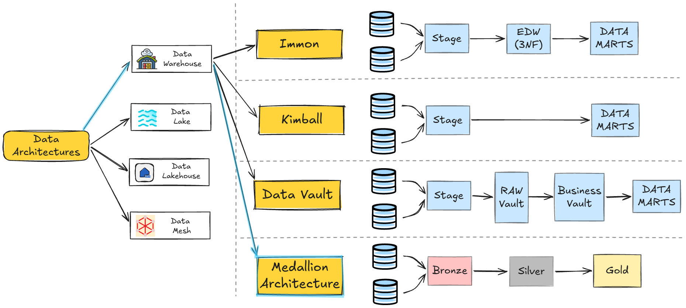
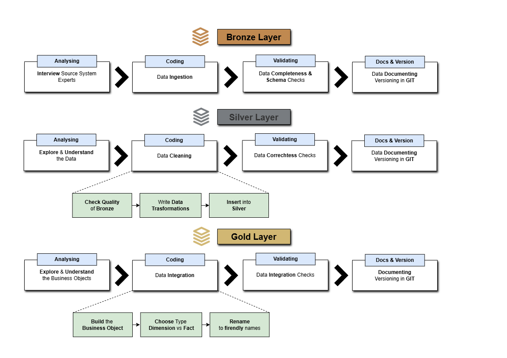
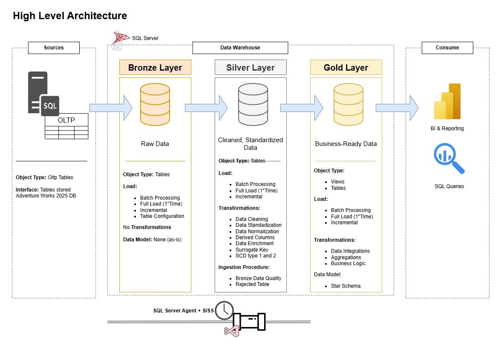
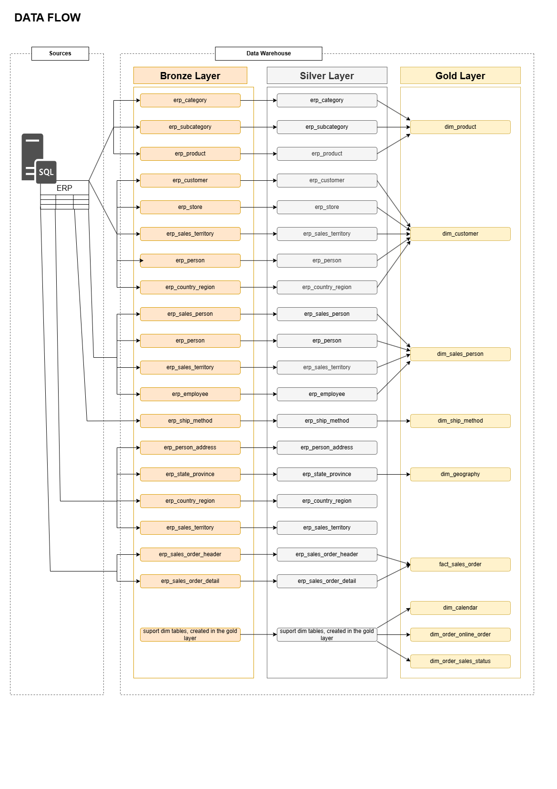

# 📊 Data Warehouse and Power BI Project


Hi everyone! Welcome to the **Data Warehouse and Power BI Project** repository.

This project builds a complete **data warehouse** for sales analysis, from the raw operational database to the reports: it is built with **Microsoft SQL Server**, orchestrated by **SQL Server Integration Services (SSIS)**, and meant to feed **Power BI** dashboards.

**Quick navigation:** [The project in 30 seconds](#-the-project-in-30-seconds) · [Requirements](#-project-requirements) · [Architecture](#-architecture) · [Pipeline](#-data-orchestration) · [Roadmap](#-roadmap) · [Repository structure](#-repository-structure) · [How to run](#-how-to-run-the-scripts) · [Documentation](#-documentation)

---

## ⚡ The project in 30 seconds

| | |
|---|---|
| **The problem** | AdventureWorks keeps its sales data in an operational database (OLTP): many tables, no history, not made for analysis |
| **The solution** | A data warehouse that collects, cleans and organizes that data, and keeps its history |
| **The source** | SQL Server database `AdventureWorks2025` (15 tables: orders, customers, products, sales people, territories...) |
| **The method** | **Medallion architecture**: Bronze (raw) → Silver (clean) → Gold (star schema) |
| **The orchestration** | One SSIS pipeline, driven by a configuration table, refreshed every night by SQL Server Agent |
| **The goal** | Answer questions on **sales trends**, **product performance** and **customer behavior** |

### Where the project is (Release 1)

| Part                                   | Status          |
|----------------------------------------|-----------------|
| Source analysis and documentation      | ✅ Done         |
| Bronze layer (raw data)                | ✅ Done         |
| Quality checks and quarantine          | ✅ Done         |
| Run log (audit of every run and step)  | ✅ Done         |
| Silver layer (clean data, history)     | ✅ Done         |
| Gold layer (star schema)               | ✅ Done: fact table, 5 dimension views, small dimensions |
| Power BI dashboards                    | 🚧 In progress  |

---

## 🚀 Project Requirements

**Building the Data Warehouse (Data Engineering)**

**Objective**

Develop a modern data warehouse using SQL Server and SSIS for the ETL orchestration, to consolidate sales and orders data and enable analytical reporting and informed decision-making.

**Specifications**

* **Data Sources:** Import data from the SQL Server OLTP database AdventureWorks2025.
* **Data Quality:** Check and clean the data before analysis. Blocking rows go to a quarantine table, every finding is logged.
* **Integration:** Data enrichment (a configuration table drives the load, derived columns) and denormalization, to provide an efficient star schema to BI tools and analytical queries.
* **Scope:** Keep the history of the data with SCD type 1 and 2, and detect anomalies with quality checks.
* **Documentation:** Provide clear documentation of the data model for business stakeholders and for the analytics team.

**BI: Analytics & Reporting (Data Analysis)**

**Objective**

Develop SQL-based analytics and Power BI reports that give detailed insight into:

* **Customer behavior**
* **Product performance**
* **Sales trends**

These insights give stakeholders the key business metrics for strategic decisions.

For the full analysis of the source system and the business rules, read the [Source System Analysis](Docs/Source_System_Analysis.md).

---

## 📐 Architecture



I decided to build a **data warehouse** because the data is **highly structured** and comes from well-defined operational systems. A data warehouse is the best place to organize this kind of information, apply governance and keep the analytics consistent.

A practical reason is the **technology available to the customer**: SQL Server and SSIS. They are reliable, widely adopted and a natural fit for a classical data warehouse.

To design the **data pipeline** I used the **Medallion architecture**, because it is simple to understand, easy to maintain and scales well when new domains or sources are added. It separates the responsibilities and simplifies the whole ETL lifecycle:

| Layer      | What it holds                                                                               |
|------------|---------------------------------------------------------------------------------------------|
| 🥉 **Bronze** | Raw data **exactly as received** from the source: traceability and reproducibility        |
| 🥈 **Silver** | Cleaned and standardized data, with business rules, surrogate keys and history (SCD 1 and 2) |
| 🥇 **Gold**   | Analytics-ready **star schema**, optimized for reports, dashboards and queries            |

### Logical steps



### High-level architecture



The data warehouse is **orchestrated** by SQL Server Integration Services (**SSIS**) and **refreshed on a schedule** by **SQL Server Agent**.

### Workflow



---

## 🎻 Data Orchestration

One SSIS pipeline runs the whole load, in this order:


| Step | What happens                                                                              |
|-----:|-------------------------------------------------------------------------------------------|
| 1    | **Start Batch**: a new run is created, so every row can be traced to one execution        |
| 2    | **Get Config Objects**: the active tables are read from the configuration table           |
| 3    | **Bronze**: each table is copied from the source, in full or incrementally                |
| 4    | **Silver**: for each table, quality check, then cleaning, history and surrogate keys      |
| 5    | **Gold**: the fact table is loaded from Silver                                            |
| 6    | **End Batch**: the run is closed as succeeded or failed (also on any error)               |

Every step of every run is written to a **run log** (`etl.load_audit`): status, duration, row counts and errors, from Bronze to Gold.

The pipeline contains **no business logic**: it only calls stored procedures. A new table is added with **one row in the configuration table**, without changing the package. Details in [SSIS Pipeline](Docs/SSIS_Pipeline.md).

---

## ✨ What makes it solid

| Feature                    | What it means                                                                                  |
|----------------------------|------------------------------------------------------------------------------------------------|
| **Metadata-driven**        | Objects, order, load type and on/off switch live in a configuration table                       |
| **Full and incremental**   | Small tables are reloaded, orders are loaded only when new                                      |
| **Data quality**           | Rules per table, a log of every finding, a quarantine for bad rows, a stop when too many are bad |
| **History**                | SCD type 2 for product, customer and sales person; type 1 for everything else                   |
| **Traceability**           | Every row carries the run (`batch_id`) and the load date                                        |
| **Run log (audit)**        | Every step of every run is logged: status, duration, row counts, watermark and errors          |
| **Change detection**       | A hash of each row tells whether it really changed                                              |
| **Safe by design**         | A full load never empties a table when the source is empty                                      |

---

## 🗺 Roadmap

Release 1 delivers the full path from the source to the star schema. The next releases:

| Area                | Next step                                                                              |
|---------------------|----------------------------------------------------------------------------------------|
| **SSIS pipeline**   | Notifications on failure, Gold dimensions in the flow                                  |
| **Gold fact**       | Incremental load, a backup table before every reload, partitioning by order date       |
| **Quality**         | Automatic reconciliation of Gold, Silver and the source                                |
| **Power BI**        | Semantic model and dashboards on the star schema                                       |

---

## 📁 Repository structure

```
.
├── Docs/        Documentation (analysis, naming rules, pipeline)
├── Images/      Diagrams used in the documents
├── Scripts/
│   ├── ETL/       Database, schemas and configuration
│   │   ├── Audit/        Run log: runs, steps and their procedures
│   │   └── Error_Event/  Quality log and quarantine
│   ├── Bronze/    Raw tables and the generic Bronze load
│   ├── Silver/    Clean tables, quality checks and Silver loads
│   └── Gold/      Fact table, dimensions and Gold load
└── README.md
```

> The SSIS project files and the connection settings are not published. The pipeline is documented in [`Docs/SSIS_Pipeline.md`](Docs/SSIS_Pipeline.md).

---

## 🛠 How to run the scripts

Run them in this order, on SQL Server with the `AdventureWorks2025` database available:

| Order | Script                                                   | What it does                                          |
|------:|----------------------------------------------------------|-------------------------------------------------------|
| 1     | `Scripts/ETL/ETL_Init_Database.sql`                      | Creates the database and the schemas                  |
| 2     | `Scripts/ETL/ETL_Config_Table.sql`                       | Creates the configuration table                       |
| 3     | `Scripts/ETL/Audit/ETL_Batch.sql`, `ETL_Load_Audit.sql`, `ETL_Start_Batch.sql`, `ETL_Audit_Procedures.sql` | Create the run log (runs and steps) and its procedures |
| 4     | `Scripts/ETL/Error_Event/ETL_Rejected_Table.sql`, `ETL_Data_quality_log.sql` | Create the quarantine and the quality log |
| 5     | `Scripts/Bronze/Bronze_DDL.sql`                          | Creates the Bronze tables                             |
| 6     | `Scripts/Silver/Silver_DDL.sql`                          | Creates the Silver tables and the sequences           |
| 7     | `Scripts/Gold/Gold_DDL.sql`                              | Creates the fact table                                |
| 8     | `Scripts/Bronze/Load_Bronze.sql`                         | Creates the Bronze load procedure                     |
| 9     | `Scripts/Silver/Coding/...`                              | Create the quality checks and the Silver loads        |
| 10    | `Scripts/Gold/Load_Fact_Sales_Order.sql`                 | Creates the Gold fact load                            |
| 11    | Run the pipeline (or the procedures, in the order of the diagram above) | Loads the data                       |
| 12    | `Scripts/Gold/Load_Dim_Table.sql`, `Scripts/Gold/View_Dim_*.sql` | Create the Gold dimensions (the calendar needs the fact loaded) |

---

## 📚 Documentation

| Document                                                       | What you find                                                              |
|----------------------------------------------------------------|----------------------------------------------------------------------------|
| [Source System Analysis](Docs/Source_System_Analysis.md)   | The kick-off with the business and IT: ER diagram, business rules, load strategy |
| [Naming Conventions](Docs/Naming_Conventions.md)                 | Every naming and design rule used in the data warehouse                    |
| [SSIS Pipeline](Docs/SSIS_Pipeline.md)                         | How the pipeline works, step by step                                       |

---

## 🧰 Tech stack

| Tool                              | Used for                                  |
|-----------------------------------|-------------------------------------------|
| Microsoft SQL Server (T-SQL)      | Data warehouse and stored procedures      |
| SQL Server Integration Services   | ETL orchestration                         |
| SQL Server Agent                  | Scheduled nightly refresh                 |
| Power BI and DAX                  | Reports and measures (in progress)        |
